### :man_technologist: About me

- :telescope: Computer Science student and developer at Fisk and Vanderbilt.
- :seedling: Forging a path in quantum computing.
- :zap: Part-time coffee lover, physicist, and dog whisperer 🤡

### :rocket: What I've been building

- **[lemon](https://github.com/TesfayeY/lemon)**: dating app for the Ethiopian and Eritrean community in the US. Flutter, Express/TypeScript, MongoDB, Firebase.
- **[WebWall](https://github.com/TesfayeY/WebWall)**: web application firewall that pairs signature matching with machine-learning anomaly detection to catch SQL injection, XSS, and previously unseen attacks.
- **[leetcode-tracker](https://github.com/TesfayeY/leetcode-tracker)**: full-stack LeetCode progress tracker. Nuxt 3, Prisma, MySQL, Docker.
- **[Interstate Quantum Hackathon 2026](https://github.com/SakxamShrestha/quant5-fisk-IQ-hackathon)**: team project on EV depot charging optimization with QAOA (Energy & Grid track).

### :hammer_and_wrench: Languages and tools

  &nbsp;
  &nbsp;
  &nbsp;
  &nbsp;
  &nbsp;
  &nbsp;
  

  &nbsp;
  &nbsp;
  &nbsp;
  &nbsp;
  &nbsp;
  &nbsp;
  &nbsp;
  &nbsp;
  &nbsp;
  

### :bar_chart: GitHub stats

  <picture>
    <source media="(prefers-color-scheme: dark)" srcset="./assets/stats-dark.svg"/>
    
  </picture>
  <picture>
    <source media="(prefers-color-scheme: dark)" srcset="./assets/top-langs-dark.svg"/>
    
  </picture>

### :snake: Contribution activity

<picture>
  <source media="(prefers-color-scheme: dark)" srcset="./assets/snake-dark.svg"/>
  
</picture>

<!--
  Stats cards and the snake are regenerated daily by .github/workflows/profile-graphics.yml.
  The header, typing line, and footer are static copies; to change them, edit the URL, re-download, and replace the file in assets/:
  header: https://capsule-render.vercel.app/api?type=waving&height=200&color=0:0A66C2,100:7F5AF0&text=Tesfaye%20Kefene&fontColor=ffffff&fontSize=56&fontAlignY=36&desc=Computer%20Science%20%C2%B7%20Fisk%20and%20Vanderbilt&descSize=20&descAlignY=58&animation=fadeIn
  typing: https://readme-typing-svg.demolab.com?font=Fira+Code&weight=500&size=22&duration=3000&pause=1000&color=2F81F7&center=true&vCenter=true&width=620&height=50&lines=Computer+Science+at+Fisk+and+Vanderbilt;Exploring+quantum+computing+with+QAOA;Building+full-stack+and+mobile+apps;Machine-learning+web+security
  footer: https://capsule-render.vercel.app/api?type=waving&height=110&section=footer&color=0:0A66C2,100:7F5AF0
  Avoid a raw "&" in the text: capsule-render doesn't escape it and the SVG breaks.
-->
